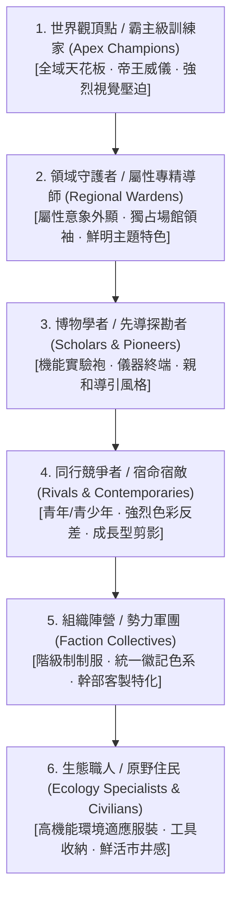

# 幻獸生態與奇幻冒險體系 · 角色設計準則規範（Character Design Guidelines）

本準則基於 2,000+ 筆同類頂尖奇幻冒險與幻獸收集遊戲之角色解構數據，提煉出工業級角色設計、視覺語意、數值比例與 3D 資產轉換的標準化架構。本規範採全去識別化抽象標準，適用於原創架空世界觀之各階層角色開發。

---

## 一、角色階層定位與體系分類（Role Hierarchy & Taxonomy）

在幻獸共生世界觀中，人類角色不直接進行肉身數值對轟，其核心存在感來自**視覺辨識度、專業定位、肢體語態以及與幻獸/隨身法具的互動關聯**。整體角色體系依其在世界架構中的功能，劃分為六大核心階梯：

### 1.1 各階層設計規範與視覺權重

| 階層類別 | 建議人口權重 | 核心受眾感知 | 典型視覺特徵 | 動作張力指標 |
|---|---|---|---|---|
| **霸主級訓練家** | 2.5% | 崇拜、極限挑戰、頂點威儀 | 寬大外披/斗篷、非對稱華麗裝飾、高飽和皇室色調、特異瞳色 | 廣角仰視、單手拋擲/展示法具、衣襬披風逆風翻卷 |
| **屬性領域守護者** | 6.0% | 專業信賴、風格鮮明、關卡門檻 | 深度綁定單一自然/以太元素（如水生機能、烈焰紋飾、金屬幾何） | 沉穩架勢、施展領域法陣、手指指向戰場核心 |
| **博物學者/先導者** | 3.0% | 引導、知性、探索求知 | 科技/魔導機能大衣、懸浮資料光屏、護目鏡、記錄手冊 | 單手推眼鏡/記錄終端、彎腰檢視幻獸、親和解說手勢 |
| **同行宿敵/競爭者** | 3.0% | 競爭意識、同行共鳴、鏡像對比 | 街頭機能裝、都會運動風格、與主角形成冷暖色相克對比 | 挑釁冷笑、雙手插袋、側身跨步、蓄勢待發 |
| **組織勢力階梯** | 8.0% | 壓迫、集團秩序、反派魅力 | **基層**：高度規格化制服＋遮蔽式面具；**幹部/首領**：高級量身剪裁＋極致個人符號 | 齊步戒備、跨立環胸、狂妄手勢、機械或儀器操縱姿態 |
| **生態職人與住民** | 77.5% | 世界真實感、生動日常、多樣性 | 專業適應裝備（登山扣、防水油布、育幼溫控包、釣具收納袋） | 專注勞作、撫摸幼獸、半蹲觀察、招攬展示珍稀道具 |

---

## 二、人口生理特徵與多樣性配比（Demographic Distribution）

為確保冒險世界觀具備可信度且符合目標用戶群體之心理投射，生理參數應維持黃金比例分佈：

### 2.1 年齡分層配置（Age Demographics）
- **核心年齡層（青少年 13–19 歲，佔比 50%）**：主角群、宿敵與新手冒險者的核心區間。體態輕盈、肢體比例修長、動作靈活且具備強烈成長潛能。
- **青壯年層（青年 20–35 歲，佔比 30%）**：領域守護者、資深先遣隊與中階幹部。肌肉線條清晰、姿態沉著歷練。
- **熟齡與長者（中年 36–55 歲佔 12%、長者 56+ 歲佔 8%）**：博士學者、隱世長老與組織領袖。具備明顯骨架特徵、歲月紋理或莊嚴體態。

### 2.2 性別與體態平衡（Gender & Anthropometry）
- **性別比例**：男女角色基礎佔比嚴格維持 **50:50**，在守護者與頂點霸主層級實施完全平等交錯分配。
- **體型維度**：
  - 男性標準體態：身高 170–185 cm，體脂率 12%–18%，重心居中微沉。
  - 女性標準體態：身高 158–172 cm，體態健康勻稱，避免過度誇張之不自然肉感，兼顧卡通美學與運動機能感。

### 2.3 人種與地域表型矩陣
避免單一文化符號的粗暴拼貼，外貌表型分為 18 大生理譜系（東亞、北歐、地中海、美洲原住民、南島語族、東非尼羅特、奇幻星民等），服飾設計依「**傳統精神意象 × 現代/未來機能剪裁**」進行二元融合，全面杜絕特定族裔刻板化標籤。

---

## 三、視覺設計法則與色彩工程（Visual Semantics & Color Laws）

### 3.1 剪影識別法則（The Silhouette Rule）
角色立繪在完全填黑（100% 黑色剪影）狀態下，必須滿足「**3 秒辨識原則**」：
1. **頭部特徵錨點**：透過誇張但結構合理的髮型剪影（如銳利刺髮、不對稱單側編髮、蓬鬆雙環）、專屬頭飾（貝雷帽、羽飾遮陽帽、魔導護目鏡）創造第一錨點。
2. **軀幹輪廓外擴**：利用披風、單肩懸掛大衣、機能背帶、非對稱護甲打破人體常規圓柱體輪廓。
3. **下盤動態支撐**：寬腿工裝褲、長靴搭扣或裙襬開衩，構成穩定之三角或動態菱形構圖。

### 3.2 60-30-10 配色定律（Palette Ratio）
每位角色之視覺色彩嚴格限制於 3–4 色調色盤之內，嚴禁無節制雜色拼合：

- **60% 基底色（Dominant）**：以低純度中性色（石墨灰、象牙白、藏青、深褐）為主，提供視覺呼吸區與材質紮實感。
- **30% 識別色（Secondary）**：表達角色屬性偏向或陣營歸屬（如代表烈焰的緋紅、森羅的薄荷青、雷霆的燦金）。
- **10% 焦點亮點（Accent）**：極高飽和度或自發光色彩，集中於**雙眼虹膜、法具核心、武器搭扣與領口細節**，引導玩家視線流動。

---

## 四、隨身收服法具與互動演繹（Vessel & Tool Integration）

角色在世界觀中收容與調動幻獸的核心媒介，是區隔普通冒險者與戰鬥名家之關鍵道具：

### 4.1 四大主流法具型態與動作語彙
1. **符籙卡片型（Talisman Cards）**：
   - *外觀*：輕薄聚合能量卡片，表面刻有符文流光矩陣。
   - *動作演繹*：雙指夾持、飛牌甩出、在胸前排列展開防護符陣；動作俐落迅捷，帶有東方玄思與魔導算力感。
2. **球形/琉璃珠型（Glass Spheres / Orbs）**：
   - *外觀*：晶瑩剔透的多面體琉璃結晶，內部封裝流動之微縮星雲。
   - *動作演繹*：上手拋接、指尖懸空旋轉、下投反彈地面釋放；節奏輕盈靈動，兼具遊藝感與掌控力。
3. **魔術幾何方塊型（Overload Hyper-Cubes）**：
   - *外觀*：精密機械合金結構，各軸向帶有可滑動發光軌道。
   - *動作演繹*：雙手快速轉動解鎖幾何卡位、單手重力上拋觸發展開矩陣；體現工業科技、邏輯計算與高威壓爆發力。
4. **原始古器/號角圖騰（Primal Totems & Relics）**：
   - *外觀*：巨獸角骨、古木雕飾、嵌有自然原石之古杖。
   - *動作演繹*：高舉呼喚、重重頓地與大地共鳴、吹響長吟；動作古樸厚重，野性張力十足。

---

## 五、生成式 AI 與 3D 管線生產轉換規範（Production Pipeline Standards）

為確保從 2D 原畫概念至 3D 拓撲動態資產無縫接軌，Prompt 鍛造與美術審查必須遵循嚴密標準：

### 5.1 三輪次獨立出圖契約（2D Art Pipeline）
- **第 1 輪：正面正交基準錨定（1:1 Front Orthographic）**：
  - *視角*：標準 T-pose，雙臂水平平展便於拓撲，平視正交，比例 1:1。
  - *光影環境*：平光漫反射無陰影，背景強制指定純色灰底（`#6B7280` / `#9CA3AF`），阻斷環境動態反光污染。
  - *核心目的*：確立不可動搖之面容五官、骨架比例、髮色瞳色與衣著細節基底。
- **第 2 輪：多視角拓撲合圖（16:9 Turnaround Sheet）**：
  - *視角*：正面、側面、背面、3/4 視角同比例水平排布。
  - *嚴格約束*：若主體配戴長斗篷或巨型背部裝飾，本輪必須繪製披風解開/掀起狀態，露出後背腰線與脊椎骨架細節，杜絕 3D 貼圖盲區。
- **第 3 輪：全身動態性格立繪（3:4 Dynamic Key Art）**：
  - *演出*：切換為專屬職業張力姿態，結合動態氣流、法具光效與特色環境氛圍光。

### 5.2 3D 建模與動作骨骼基準（3D Model & Rigging Spec）
1. **面數與材質階梯**：
   - 角色幾何體控制於 **35k–45k 三角面（Tris）** 區間。
   - 貼圖規格：單主體採用 2048×2048 PBR 貼圖（BaseColor, Normal, Metallic, Roughness, Emissive）。
2. **表情系統**：
   - 標配 **ARKit 52 組面部 BlendShapes**，涵蓋眉弓、眼裂閉合、嘴角牽引與視線注視方向。
3. **基礎動作庫清單（33 組標準剪輯）**：
   - **待機週期**：一般待機（`idle` 60 幀）＋ **長時間定力深呼吸微動（`idle_long` 120 幀循環，極低頻胸腔起伏、重心微調無漂移）**。
   - **位移系統**：走（`walk`）、跑（`run`）、潛行待機與移動（`sneak`）、翻滾閃避無敵幀（`roll_dodge` 20 幀）。
   - **指令與戰鬥互動**：指向命令（`command_point`）、攻擊宣告（`command_attack`）、撤退回防（`command_recall`）、召喚幻獸（`summon`）、收回幻獸（`recall`）。
   - **法具專屬演繹**：甩牌投擲（`throw_card` 24 幀）、琉璃珠下手拋（`throw_bead` 28 幀）、方塊旋動拋投（`throw_cube` 32 幀）。
   - **共生牽絆撫摸**：依幻獸尺寸分為 5 階撫摸專用動作（`pet_xs` 掌心撫摸、`pet_s` 蹲下摸頭、`pet_m` 彎腰輕拍、`pet_l` 抬手摸頸、`pet_xl` 雙手抱撫低頭巨獸）。

---

## 六、原創性審查與敏感性自檢清單（Compliance Checklist）

在資產定案與驗收入庫前，技術美術與概念設計師必須逐一核對以下紅線：

- [ ] **去商業品牌化**：無任何知名既有商業 IP 之標誌性服飾、雙色球狀專利外觀或特有名詞。
- [ ] **文化意象審查**：民族風服飾是否為「當代剪裁 × 符號抽象化」，若涉及神聖圖騰是否標記 `sensitivity: review` 進行人工替換。
- [ ] **剪影自檢**：純黑剪影下，頭部、肩線、法具手勢與下盤站姿是否具備唯一辨識度。
- [ ] **色彩純淨度**：是否嚴格恪守 60-30-10 配色定律，背景色是否未侵蝕角色主體邊緣。
- [ ] **3D 可實作性**：是否具備遮擋物解構圖，衣襬厚度與關節交界處是否留有合理拓撲緩衝間隙。
