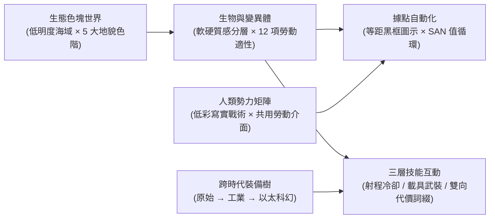
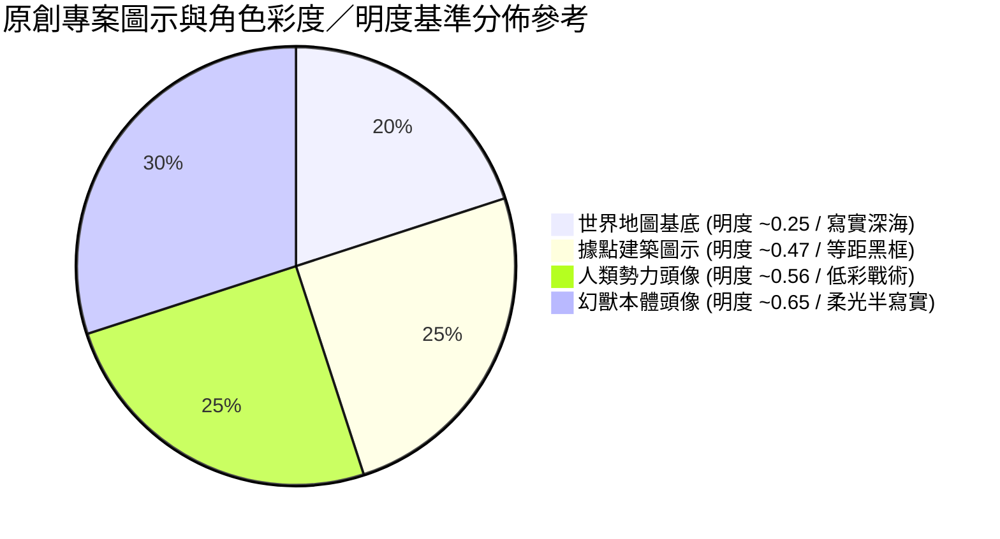

# 幻獸共生與工業生存體系 · 視覺與文本分析暨去識別化設計指南

本文件參考 `pokemon_data/` 角色設計準則之抽象化方法，對 `palworld_data/` 全 8 大類別之結構化數據與圖像資產進行定量與定性解構，並據此提煉出可安全應用於原創專案的**去識別化設計指南**。

---

## 一、資料集全貌盤點（Dataset Inventory）

| 資料項目 | 文本／數值檔案 | 筆數 | 圖像目錄 | 圖像數與格式 | 預設尺寸 |
|---|---|---:|---|---|---|
| **幻獸本體** | `pals.json` | 299 | `images/pals/` | 299 `.webp` (RGBA) | 128×128（1 筆 512×512） |
| **人類角色** | `humans.json` | 433 | `images/humans/` | 433 `.webp` (RGBA) | 128×128 |
| **道具裝備** | `items.json` | 1,864 | `images/items/` | 1,864 `.webp` (RGBA 1,862 / RGB 2) | 256×256（13 筆 512×512、1 筆 128×128） |
| **據點建築** | `constructions.json` | 498 | `images/constructions/` | 498 `.webp` (RGBA) | 256×256（20 筆 512×512） |
| **主動技能** | `active_skills.json` | 375 | — | — | — |
| **夥伴技能** | `partner_skills.json` | 460 | — | — | — |
| **被動詞綴** | `passive_skills.json` | 412 | — | — | — |
| **世界與地標** | `world_maps.json` / `regions.json` / `maps.json` | 2 / 80 區 / 14,193 點 | `images/world_maps/` | 2 `.png` (RGB) | 2048×2048 |

---

## 二、各項目視覺與文本分析（Visual & Textual Analysis）

### 2.1 幻獸本體（`pals.json` + `images/pals/`）
- **視覺分析**：
  - **渲染與構圖**：採 3D 柔光半寫實渲染（無粗黑描邊），透明去背頭像（抽樣 100 筆中 99 筆具透明背景），平均彩度 `0.362`、平均明度 `0.650`，色彩溫和飽滿但不過度螢光。
  - **造型光譜**：從初期圓潤球狀、毛絨材質（高親和力、低威脅感）過渡至高階流線型機械／龍類構造（銳利稜角、金屬與發光細節）。
  - **亞種機制**：共計 84 筆元素變異體（佔比 28.1%），透過**主體色相置換＋局部角飾／材質微調**快速擴充屬性覆蓋率，同時維持原種核心剪影。
- **文本分析**：
  - **屬性分佈（9 屬性）**：暗（73）、水（48）、草（47）、火（44）、地（44）、無（41）、冰（38）、雷（25）、龍（25），暗與自然基礎屬性佔主導。
  - **勞動適性（12 項）**：搬運（148）、採集（111）、手工作業（109）、採伐（64）、挖掘（57）、澆水（46）、播種（45）、生火（44）、製藥（43）、冷卻（38）、牧場（29）、發電（25），將生物直接映射為據點自動化節點。
  - **數值結構（52 欄 `detailed_stats`）**：除戰鬥三圍外，精細定義碰撞膠囊尺寸（`MeshCapsuleHalfHeight` / `Radius`）、5 段移動／騎乘／游泳速度、食量、SAN 值與友誼強化係數。
  - **圖鑑敘事**：`summary` 長度 26–111 字（平均 59.1 字），語氣偏向「**客觀生態觀察＋黑色幽默／食物鏈殘酷寫實**」，與柔和視覺形成反差記憶點。

### 2.2 人類角色與勢力體系（`humans.json` + `images/humans/`）
- **視覺分析**：
  - 全數 433 筆為 `128×128` RGBA 透明去背頭肩胸像（抽樣 87/87 全數去背）。
  - 平均彩度 `0.242`、平均明度 `0.560`，為角色類別中**彩度最低、色調最寫實沉穩**的一組。大量運用戰術兜帽、防毒面具、紅眼發光護目鏡與深灰／黑／米白機能服飾，強化「匿名集團壓迫感」與「荒野生存感」。
- **文本分析**：
  - **勢力與職業結構**：依 `id` 前綴可歸納為一般男女住民（`Male` 72、`Female` 38）、盜獵武裝集團（`Hunter` 55）、競技場訓練師（`Arena` 45）、懸賞通緝頭目（`BOSS` 34）、治安防衛隊（`Police` 23）、狂熱教團（`FireCult` 10）、保護組織（`Believer` 12）、極地部族（`Viking` 8+）、隱密忍者眾（`Ninja` 5+）及科研部隊（`Scientist` 5）等。
  - **系統一致性**：100% 人類條目皆配置 `work_suitability`（手工作業 433、挖掘 423、採伐 392），代表人類在機制層面與幻獸共用同一套勞動與戰鬥底層介面。

### 2.3 道具、武器與裝備（`items.json` + `images/items/`）
- **視覺分析**：
  - 99.2% 為 `256×256` RGBA 去背圖示（抽樣 82/82 全數去背），平均彩度 `0.420`（道具建築類最高）、平均明度 `0.535`。
  - **統一視覺語彙**：採**斜 45 度等距展示＋明確黑色外輪廓描邊＋寫實 PBR 磨損貼圖**（如槍械烤漆刮痕、金屬反光與能量核心微光），確保在小尺寸背包格中仍具備高辨識度。
- **文本分析**：
  - **12 大分類**：設計圖（601）、重要物品（331）、消耗品（230）、材料（189）、武器（131）、食材（124）、防具（109）、飾品（87）、彈藥（38）、收容球（11）、滑翔傘（7）、模組（6）。設計圖佔比高達 32.2%，反映「配方驅動＋稀有度刷取」的核心循環。
  - **5 階稀有度**：常見（555）、史詩（376）、稀有（340）、傳奇（304）、少見（289）。
  - **敘事跨度**：文本同時涵蓋石器木棒、近代自動步槍與科幻電漿裝備，建立「跨時代工業演進」的世界觀張力。

### 2.4 據點建築與生產設施（`constructions.json` + `images/constructions/`）
- **視覺分析**：
  - 96.0% 為 `256×256` RGBA（478 筆），其餘為 `512×512` RGBA（20 筆），抽樣 83/83 全數去背。
  - 平均彩度 `0.346`、平均明度 `0.466`（所有圖示中明度最低），採**等距 3/4 俯視角＋黑色外輪廓描邊**，以粗獷原木、石塊、鍛鐵與工業管線呈現真實比例的建築體量感。
- **文本分析**：
  - **10 大分類**：家具（159）、地基（139）、生產（45）、儲存（30）、基礎設施（25）、專屬設施（23）、照明（22）、其他（20）、防禦（19）、食物（16）。
  - **說明結構**：簡潔標註「科技階梯需求」、「SAN 值影響係數」與「所需工作適性類型」，功能導向明確。

### 2.5 技能與詞綴矩陣（`active_skills.json` / `partner_skills.json` / `passive_skills.json`）
- **主動技能（375 筆）**：涵蓋 9 屬性與無屬性（另有 26 筆無標註），威力範圍 `0–1250`（平均 `325.9`，僅 4 筆為 0 威力輔助技），冷卻 `0–300` 秒（平均 `21.3` 秒），並於文本標註射程區間與異常狀態積蓄值。
- **夥伴共鳴技能（460 筆）**：以多維度協同為主，關鍵字覆蓋：隊伍／屬性強化（331）、牧場掉落產出（91）、陸地騎乘（90）、空中飛行／滑翔（65）、水上游泳（23）、重火力武裝化（21）、採集輔助（17）、護盾／穿戴裝備（10）。
- **被動詞綴（412 筆）**：涵蓋 `-3` 至 `+5` 共 8 個階級。正向 1 階（222 筆）構成基礎池；負向詞綴（`-1` 21 筆、`-2` 2 筆、`-3` 3 筆）提供生態隨機缺點；頂級 `5` 階詞綴（7 筆）強制採用**「極端增益＋明確負面代價」**（如工作速度 +90% 但 SAN 下降 +15%、攻擊 +40% 但最大 HP -50%）以維持系統張力。

### 2.6 世界地圖與空間節點（`world_maps.json` / `regions.json` / `maps.json` + `images/world_maps/`）
- **視覺分析**：
  - 2 張 `2048×2048` RGB 衛星俯視寫實地形圖，深海暗藍基底（平均明度 `0.251`、彩度 `0.551`），以青藍發光邊框界定可探索海域。
  - 地貌色塊高度區隔：溫帶翠綠群島、北方雪原冰川、東北黃白荒漠、中左暗紅熔岩火山與西南紫暗異界地帶，玩家無需文字即可從地圖顏色判讀環境威脅與資源帶。
- **文本與空間分析**：
  - 主島群劃分 80 個區域與 13,814 筆空間標記，世界樹區域含 379 筆標記（合計 14,193 筆）。
  - 標記類別高度集中於「頭目／地下城節點（14,166 筆）」，輔以「洞穴入口（18 筆）」與「鑑賞家 NPC（9 筆）」，呈現以**高密度探索點與首領挑戰**為核心的開放世界節奏。

---

## 三、去識別化設計指南（De-Identified Design Guidelines）

為承襲「**生態共生 × 工業自動化 × 跨時代武裝 × 黑色幽默**」之設計優勢，同時徹底消除既有商業 IP 識別特徵，原創專案須遵循以下六大規範：

### 3.1 幻獸與變異體設計規範
1. **渲染與比例雙軌**：
   - 保留「3D 柔光半寫實、無粗黑描邊」之生物立繪／頭像風格（平均彩度 `0.35–0.40`、明度 `0.60–0.70`），與高對比描邊的 UI 道具形成視覺前後景分離。
   - 嚴禁使用原作雙色捕獲球圖騰或高度近似之吉祥物輪廓。
2. **元素亞種擴充法則（25%–30% 變異比）**：
   - 同一基礎骨架可衍生 1–2 種元素亞種，但必須同時變更**主色相＋表面材質（如絨毛轉冰晶／熔岩紋）＋至少一處頭部／尾部剪影飾件**，不得僅做全圖色相旋轉。
3. **圖鑑文本基調**：
   - 控制於 **40–90 字**，採用「**自然生態習性描述 ＋ 一句反差感生存／工業用途冷知識**」，避免使用任何原作專有名詞。

### 3.2 人類勢力與勞動力統一規範
1. **去識別化六大勢力原型**：
   - **荒野掠奪者**（深灰／卡其戰術裝＋遮面頭套，負責野外伏擊與非法收容）
   - **邊境防衛隊**（藏青／鐵灰制式護甲＋制式槍械，負責據點巡邏與通緝執法）
   - **元素狂熱教團**（暗紅／焦黑兜帽長袍＋發光面具，綁定單一元素武器）
   - **極端生態派**（白／淺綠機能服＋簡易近戰具，主張反工業化）
   - **古文明遺民**（毛皮／青銅／織紋混合剪裁，駐守極地或遺跡）
   - **禁忌科研部**（無菌白／銀灰防護服＋實驗面罩，持有高階能量武器）
2. **色彩紀律**：人類頭像維持低彩度（`< 0.28`）與中低明度（`0.50–0.58`），僅在**面罩目鏡、勢力臂章或武器能量核**保留 10% 高飽和焦點色。
3. **介面統一**：人類與生物共用同一套「工作適性／戰鬥數值」資料契約，允許 NPC 作為護衛、商人或據點駐守者運作。

### 3.3 道具、武器與建築圖示規範（UI Icon Contract）
1. **統一圖示管線**：
   - 所有背包道具與建築縮圖一律採用 `256×256` RGBA（大型奇觀建築可用 `512×512`），**斜 45 度或 3/4 等距視角＋固定像素寬度黑色外輪廓描邊＋寫實 PBR 表面磨損**。
   - 建築明度控制在 `0.42–0.50`，道具明度 `0.50–0.58`，確保在深色 UI 面板中清楚分層。
2. **收容法具去專利化**：
   - 禁止任何「紅白／雙色對半球體」設計。改用**多面體晶核、符文鎖匣、幾何折疊艙或共振羅盤**作為收容媒介，並透過發光線條顏色區分階級。
3. **三段式科技樹視覺**：
   - **原始期**（粗木、麻繩、碎石）→ **工業期**（鉚釘鋼板、內燃管線、烤漆火器）→ **以太／科幻期**（無縫複合材、電漿導軌、懸浮核心）。

### 3.4 三層技能與雙向詞綴平衡規範
1. **主動技契約**：每項技能必須明確定義「屬性、基礎威力（建議 0–1200 區間）、冷卻秒數、有效射程、狀態異常積蓄值」，避免無冷卻或無射程邊界之模糊設計。
2. **夥伴共鳴四大互動軸**：設計原創幻獸時，優先為其分配至少一項跨系統共鳴能力——**① 移動載具化（陸/空/水）**、**② 隨身重武器／護盾化**、**③ 據點牧場／採集特化**、**④ 屬性光環增益**。
3. **高階詞綴「收益—代價」對稱原則**：高階（Rank 4–5）被動詞綴不得為純粹數值膨脹，必須綁定至少一項**管理層面代價**（如 SAN 值消耗加速、飽食度下降加劇、或防禦／生命折損），維持據點管理與戰鬥配裝之策略取捨。

### 3.5 世界地圖與探索節奏規範
1. **衛星地形色塊法**：世界地圖採 `2048×2048` 以上頂視寫實渲染，以深海暗藍（明度 `< 0.30`）襯托五大高對比生態帶（翠綠溫帶、純白冰原、沙黃荒漠、赤黑火山、紫暗異域），讓玩家憑直覺規劃探索路線。
2. **節點密度分層**：以「地下城入口、區域首領、特殊商人／鑑賞家」構成明確座標網格，並將高階挑戰節點集中於外圍極端生態帶。

---

## 四、去識別化合規自檢清單（Compliance Checklist）

- [ ] **名詞與圖騰隔離**：全數移除「帕魯」、「帕魯球」、「帕洛斯」及原作六大勢力專有名詞；收容道具絕無雙色對半球形外觀。
- [ ] **視覺前後景分離**：生物與人類頭像維持「無粗黑描邊之 3D 柔光／寫實渲染」，道具與建築圖示維持「等距視角＋黑色外輪廓描邊」。
- [ ] **變異體差異度**：元素亞種除色相外，至少具備 1 項材質替換與 1 項輪廓配件調整。
- [ ] **數值代價平衡**：所有頂級（Rank 5）被動詞綴皆附帶明確負面管理代價（SAN／飽食／防禦折損）。
- [ ] **勞動力介面一致**：人類 NPC 與幻獸皆納入統一的工作適性與據點消耗（SAN／食量）排程模型。
