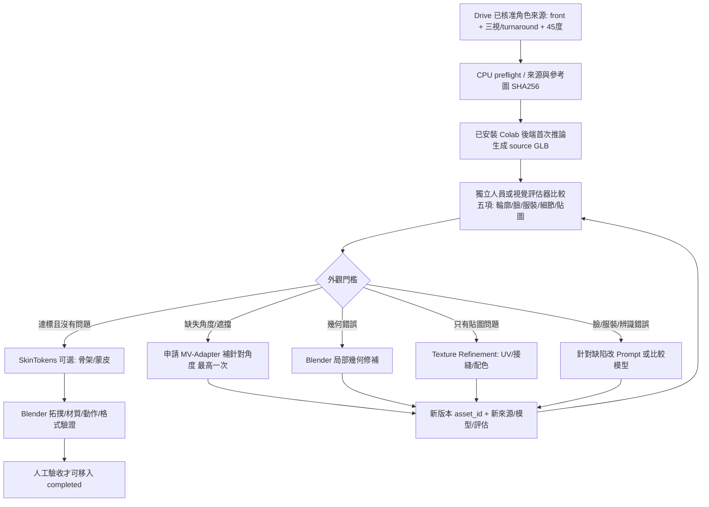

# 角色 Colab Image-to-3D：初始四視角、條件補圖與品質閘門

> GitHub `docs/pipeline/characters/03a_colab.prompt.md` 與本文件是共用流程**維護正本**。Google Drive 同名通用模板／流程圖為唯讀發布鏡像；角色個別圖、asset_spec、QA、GLB 等只存 Drive。

## 執行順序與邊界



目前已實作：參考圖路徑／hash 驗證、GLB 原始輸出及 hash 綁定、品質報告 Schema 驗證、單次決策、擋下未評分或未達門檻的綁骨、留存 `typed_state.json`、`qa/appearance_gate.json`、`manifest.json`。**尚未實作**：實際自動視覺評分器、MV-Adapter 生成器、Texture Refinement 執行器、跨模型自動批次比較與修圖／選模；本版只明確提出動作供人員或另外驗證過的 adapter 執行，不得宣稱已自動修復。

## 個別 Drive 設定（不可提交 GitHub）

角色 spec（`characters/<subject_id>/00_settings/asset_spec.json`）使用獨立 asset_id；啟用新版（舊任務不受影響）：

```json
{
  "asset_id": "<asset_id>",
  "subject_id": "<subject_id>",
  "source_pack": "<approved_portrait_pack>",
  "source_image": "images/front.png",
  "category": "character",
  "task_type": "character-model-rig",
  "input_mode": "image",
  "asset_class": "humanoid",
  "license_status": "verified",
  "character_colab_workflow": "character-colab/2",
  "reference_views": {
    "front": "images/front.png",
    "turnaround": "images/turnaround.png",
    "three_quarter_45": "images/three_quarter_45.png"
  },
  "generation_attempt": 1,
  "max_auto_retries": 2,
  "mv_adapter_passes": 0
}
```

三視合圖和 45° 圖是外觀一致性參考，**不是**已校準的 Pixal3D 多視角輸入。只有在來源包下有真實 `multiview_dir/transforms.json` 與 2～16 張校準圖片時，`anime3d_backend_adapter.py` 才能切換 `inference_mv.py`。驗證來源時需有 `reviews/<source_pack>.json` 的真人 `status=ok`，不得由前置檢查自行製造批准。若資料夾為 `characters/<id>/` 三層形式，先確認相容的 runner staging 規則；目前 Python runner 仍按 `<category>/01_portraits/<source_pack>/` 或 `03_completed/portraits/<source_pack>/` 驗證，不可假定已支援全部 Drive 新舊路徑。

## 外觀評估報告（外部評估器／真人生成）

在首次 GPU 結束後，由確實看過多角度模型渲染及已核准參考圖的評估者，於目前工作包寫 `qa/appearance_review.json`：

```json
{
  "schema": "cosmimera-character-appearance-review/1",
  "asset_id": "<asset_id>",
  "model_sha256": "<SHA-256 of source/<asset_id>.glb>",
  "reference_sha256": "<reference_sha256 from qa/reference_views.json>",
  "reviewer": "<person or evaluated tool/version>",
  "method": "human",
  "scores": {
    "silhouette": 0.9,
    "face": 0.88,
    "outfit": 0.87,
    "details": 0.86,
    "texture": 0.8
  },
  "issues": []
}
```

門檻是**專案自訂起始值**，並非官方模型評測或有保證的辨識準確率：輪廓 ≥ 0.82、臉 ≥ 0.85、服裝 ≥ 0.82、細節 ≥ 0.80、貼圖 ≥ 0.76。所有指標達標且 `issues=[]`，輸出 `next_action=CONTINUE_RIG` 才可進入綁骨；缺報告、評估者／方法、資料或雜湊不符，一律阻擋。評估分數可由人工或真實外部視覺模型提供，runner **不會**自行生成分數。

`issues` 中的 `type` 可為 `missing_angle`、`occlusion`、`geometry`、`identity`、`outfit`、`details`、`texture`、`uncertain`，搭配定位及觀察。決策優先級：
1. 缺角度或遮擋且 `mv_adapter_passes=0` → `REQUEST_MV_ADAPTER`（僅生成需要的角度，檢查與原角色一致；不無條件補圖）。
2. 網格缺陷 → `REPAIR_GEOMETRY`。
3. 輪廓、臉部、服裝、細節缺陷 → `REVISE_PROMPT_OR_COMPARE_BACKEND`，達最多三次生成後改為 `HUMAN_REVIEW_MODEL`，不可只換 seed 重抽。
4. 僅材質分數不足／貼圖缺陷 → `REFINE_TEXTURE`。
5. 無法判定或剩餘問題 → `HUMAN_REVIEW_MODEL`。

重建必須建立新的 asset_id，保存原模型及歷次缺陷和候選，不能覆寫早先的 `source/`；如改動圖像或 backend，也需新資產版本。局部貼圖、幾何修補需要重新輸出、重新評分、保留可追溯檔案；此版本尚未提供自動執行器。

## Notebook / GPU 隔離

使用 `notebooks/07_batch_runner.ipynb`，指定 Drive 個別 spec。先 `STAGE=pre_gpu`，再 `STAGE=gpu` 生成 source GLB；GPU 階段成功後即安排 Colab guard 關閉 GPU。由另外的人工／視覺評估器產生報告後，設定 `STAGE=post_gpu` 與 `RIG_BACKEND=skintokens`（只有真正安裝隔離 runtime 時），再執行 Blender QA。GPU 生成完成但待評估，不是模型合格，也不是人工核准。

任務要保留 `qa/reference_views.json`、`qa/appearance_review.json`、`qa/appearance_gate.json`、`typed_state.json`、`manifest.json`，以及真的產生的 `.glb`、`.blend`、`rig/`、`animations/` 與 `previews/`。CI 可以用合成資料測試邏輯，不啟動 GPU，不使用個別角色檔案。

## 驗證

```bash
python -m unittest tests.test_anime3d_character_quality -v
python -m unittest discover -s tests -p 'test_anime3d*.py' -v
node --test tools/tests/test_pipeline.cjs tools/tests/test_task_flow.cjs
```

本規範不能替代真正的模型藝術品質驗收；未經人工核准的資產不得移入完成區。
